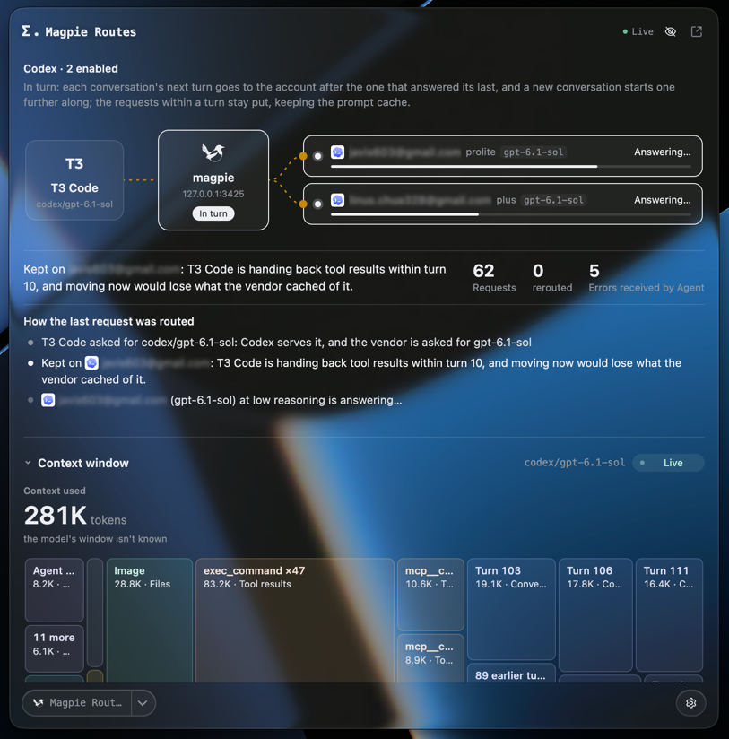
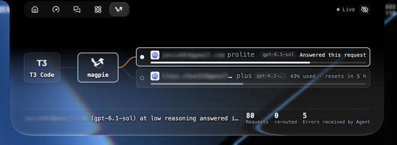
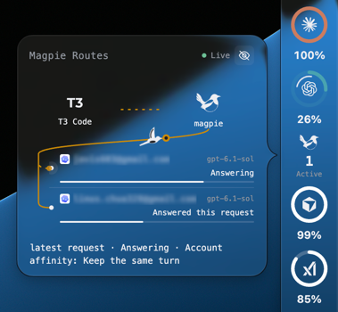

# Magpie Routes

Roteamento local do Magpie em tempo real, resumos de contexto e solicitações recentes no Token Monitor.

### Janela principal

### Painel do notch

### Edge Dock

## Compatibilidade e instalação

Requer **Token Monitor 0.81.0 ou posterior**. Instale o Token Monitor e execute o Magpie no mesmo computador. Em **Configurações → Plugins → Instalar de arquivo**, importe a pasta completa ou o `.tmplugin`, revise e ative. Não é necessário instalar o Node.js separadamente. O Painel do notch está disponível em Macs compatíveis.

## Visualizações

**Página principal**: grafo de rotas, explicação das decisões, tempos, contexto e solicitações recentes. Selecione uma solicitação para fixá-la e depois retorne ao modo ao vivo.

**Painel do notch**: rotas ao vivo, filtro de agentes, ocultação de contas e estatísticas nos controles do host; exige um host macOS compatível.

**Edge Dock**: ícone e contagem de solicitações no modo compacto; rotas e contas no cartão expandido.

Esses três locais são sugeridos na primeira instalação e podem ser alterados ou removidos na confirmação. Atualizações preservam os locais existentes e não ativam Painel do notch, Dock ou execução em segundo plano automaticamente.

## Configurações

Escolha a porta nas configurações do plugin. O valor `0` usa a porta configurada no Magpie ou `3425` quando não há configuração.

Os nomes das contas ficam ocultos por padrão, com a mesma opção em todas as visualizações. Selecione uma solicitação recente para fixá-la ou volte ao modo ao vivo. Se o Magpie estiver offline, o plugin mantém os últimos dados e tenta reconectar automaticamente.

A interface oferece inglês e chinês tradicional/simplificado; outros idiomas do aplicativo usam inglês.

## Dados e execução

O plugin lê metadados locais de roteamento, concorrência e contexto do Magpie. Não envia solicitações a modelos, não lê os corpos de solicitações/respostas, não altera contas ou configurações de roteamento e não salva o histórico de rotas em disco.

A ocultação das contas afeta apenas a exibição. Os metadados podem conter nomes de ferramentas ou caminhos de arquivos. O plugin é executado com as permissões do usuário local.

## Licença e manutenção

Integração da comunidade Token Monitor, **não é um produto oficial do Magpie**. Parte do código e das imagens adapta [yetone/magpie](https://github.com/yetone/magpie). O código original usa [MIT](LICENSE); a atribuição e a licença upstream estão em [SOURCE-NOTICE.md](SOURCE-NOTICE.md) e [MAGPIE-LICENSE.txt](MAGPIE-LICENSE.txt).

[Histórico de alterações](CHANGELOG.pt-BR.md) · [Todos os plugins](../../README.pt-BR.md)
