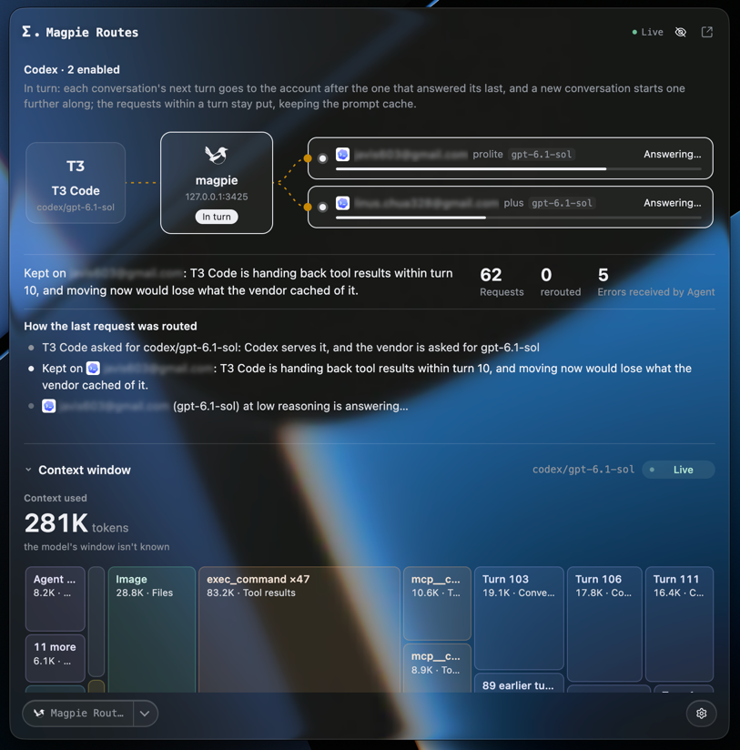
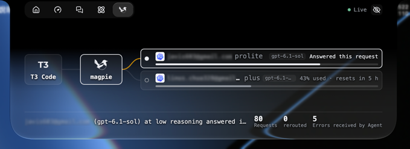
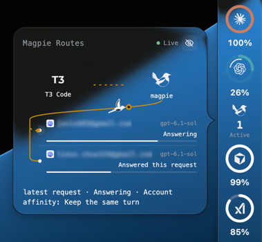

# Magpie 路由

在 Token Monitor 查看本机 Magpie 的实时路由、上下文摘要及近期请求。

### 主窗口

### 刘海面板

### 侧边栏

## 兼容性与安装

需要 **Token Monitor 0.81.0 或更新版本**。安装 Token Monitor，并在同一台电脑运行 Magpie。在 **设置 → 插件 → 从文件安装** 中导入完整插件文件夹或 `.tmplugin`，查看后启用。用户无需另装 Node.js。刘海面板 适用于支持该功能的 Mac。

## 显示位置

**主页面**：路由图、决策说明、时间分布、上下文与近期请求。选择请求可固定查看，再返回实时。

**刘海面板**：使用宿主顶部操作区显示实时路由、Agent 筛选、账号打码及统计；需要支持此功能的 macOS 宿主。

**侧边栏**：窄栏显示图标和请求数，展开卡片查看路由及账号列表。

首次安装建议这三个位置，可在安装确认中修改或清空。更新保留原有位置，不会自动开启 刘海面板、Dock 或后台执行。

## 设置与使用

在插件设置选择连接端口。保留 `0` 会读取 Magpie 配置中的端口；未配置时使用 `3425`。

账号名称默认打码，选项会同步到各个界面。可选择近期请求固定查看，或返回实时视图。Magpie 离线时保留最后数据，并自动尝试重新连接。

界面支持英文、繁体中文及简体中文，其他 App 语言使用英文。

## 数据与执行

插件从本机 Magpie 读取路由、并发状态及上下文 metadata，不发送模型请求、不读取请求／响应正文、不修改 Magpie 账号或路由设置，也不把路由历史保存到磁盘。

账号打码只影响显示，metadata 可能包含工具名称或文件路径。插件以本机用户权限运行。

主页还提供多会话上下文、按请求／会话／密钥分组、用途筛选及指标。历史日浏览与回放读取 Magpie 已有的本地路由目录，账号用量窗口来自已保存的用量卡片接口；不改写历史、不向供应商刷新用量，也不修改账号设置。会话使用匿名编号，不载入请求正文或由提示词生成的标题。

Magpie 使用便携版或自定义文件夹时，请将“Magpie 数据目录”设为绝对路径，指向内含 settings.json 和 routing/ 的文件夹；留空使用标准位置。没有定价数据时隐藏美元成本排序，保留实际回报的 credits。损坏的压缩历史会跳过，并提示记录可能不完整。

请求列表每页显示 100 条；排序、筛选、群组统计和重播仍涵盖整个选定范围。

## 授权与维护

Token Monitor 社区集成，**并非 Magpie 官方产品**。部分代码和图像改编自 [yetone/magpie](https://github.com/yetone/magpie)。原创代码采用 [MIT](LICENSE)，上游来源及授权详见 [SOURCE-NOTICE.md](SOURCE-NOTICE.md) 和 [MAGPIE-LICENSE.txt](MAGPIE-LICENSE.txt)。

[版本记录](CHANGELOG.zh-CN.md) · [全部插件](../../README.zh-CN.md)
